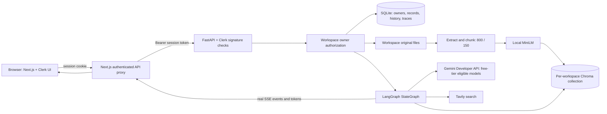
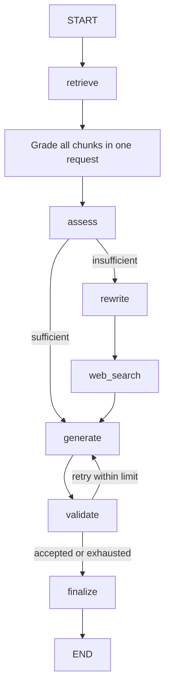

# Aether Research architecture

Clerk authenticates people. FastAPI authorizes their account-owned workspaces.
The public landing page is `/`; the authenticated lab is `/research`.

All workspace-path endpoints pass through `authorize_request` and
`require_workspace_owner`. Chat checks the body workspace ID before reserving a
conversation. Child document/conversation/run IDs must also belong to that
workspace. Legacy rows with null ownership remain hidden until explicitly claimed.

The API intersects Google's published free Standard input/output prices with the
key's accessible text-generating Gemini models. A chat gets the chosen model and
all other verified candidates, with one extra attempt per operation for transient
transport/server failures. Node calls use
`call_with_free_fallback`; actual switches emit `model_fallback`. The request's
plan is reused by later workflow nodes, never across users or conversations.
Grading uses one batch with exact, unique chunk-ID coverage; scores are matched by
ID rather than response order. Missing/duplicate/unknown IDs fail closed.
Each operation is limited to three model attempts and 75 seconds by default;
timeouts switch models directly when alternatives remain. Small structured
judgments have a 2,048-token cap, separate from the answer's 8,192-token cap.
Provider failures in grading, assessment, or validation propagate to the SSE
error handler instead of being interpreted as irrelevant/insufficient evidence.

The composer exposes a 0–100% minimum document relevance control beside model
selection, initially 50%. Zustand retains the choice across chats within the
current signed-in page session; reload/account reset restores 50%. `use-chat`
sends the percentage as `relevance_threshold` on the 0–1 scale, including for
regeneration. `ChatInput` validates the range and rejects non-finite values.
The route overrides only its copied graph settings; it does not update SQLite
AppSettings. Omitted values retain the internal default. The control is disabled
during streaming, and sufficiency and grounding validation remain unchanged.
Preferences uses the same Zustand value. Intelligence displays the actual cutoff
from the completed grading event, so changing the next request's control does not
relabel an earlier run. The landing-page preview illustrates the default cutoff.

The browser's active request lives in `lib/research-stream.ts`, outside mounted
React views. `useChat` exposes its shared send/stop functions. View switches and
client-side page navigation preserve the stream and Zustand state; same-account
page initialization is idempotent. A root `ResearchSession` component watches
Clerk auth changes. Sign-out/account changes reset private state and synchronously
abort the old request. A request sequence guards streamed events and delayed
history refreshes against stale account/run updates. Switching browser tabs does
not cancel research. Full reloads, closed tabs, and network disconnects remain
interruptions; this does not add a durable background job or resume protocol.

## Files

| File | Purpose |
|---|---|
| backend/app/core/auth.py | Clerk verification and ownership dependency |
| backend/app/core/config.py | Root/backend dotenv configuration |
| backend/app/models/database.py | Tables, nullable ownership migration, SQLite setup |
| backend/app/api/routes.py | Protected CRUD, free catalog, model selection, actual SSE |
| backend/app/agents/state.py | Typed state and structured Pydantic judgments |
| backend/app/agents/nodes.py | Batched grading, retrieval, sufficiency, generation, validation |
| backend/app/agents/graph.py | One conditional StateGraph |
| backend/app/services/free_models.py | Verified free catalog and compatibility ordering |
| backend/app/services/ai.py | Gemini, bounded free fallback, Tavily |
| backend/app/services/documents.py | Extraction and staged indexing |
| backend/app/services/vector.py | Local embeddings and persistent collections |
| backend/scripts/claim_legacy.py | Explicit ownership assignment with backup |
| frontend/proxy.ts | Clerk-protected research/API routes |
| frontend/app/api/backend/[...path]/route.ts | Session-bearing proxy and SSE/file forwarding |
| frontend/app/page.tsx | Public landing page |
| frontend/app/research/page.tsx | Protected lab and setup gate |
| frontend/app/sign-in and sign-up | Clerk-hosted UI components |
| frontend/components/research-app.tsx | Personal sidebar and account controls |
| frontend/components/workspaces.tsx | Private workspace creation, selection, rename, deletion |
| frontend/components/free-model-picker.tsx | Free model selection before generation |
| frontend/components/relevance-picker.tsx | Minimum document relevance percentage beside the composer model picker |
| frontend/components/chat.tsx | Markdown, question composer, citations |
| frontend/components/intelligence.tsx and workflow.tsx | Real evidence and compact graph/Learn Mode |
| frontend/hooks/use-chat.ts | Shared session-owned send/stop controls |
| frontend/lib/research-stream.ts | Navigation-independent SSE lifecycle and stale-response guards |
| frontend/components/research-session.tsx | Root Clerk auth observer; account changes clear private state |
| frontend/stores/research.ts | Session-cleared shared UI state |

Settings and the standalone Agent Workflow page are removed. The compact graph
remains inside Intelligence, with actual events and node explanations.

Uploads measure real transfer progress; indexing has no invented percentage.
SQLite and Chroma do not share an ACID transaction; reindexing stages a new version
and preserves the old version on ordinary failures. Source text is untrusted.
No authentication bypass or simulated workflow events exist in application code.
The test suite overrides identity only within test fixtures.

## Gemini catalog and fallback

The backend intersects Google's live free-tier pricing with authenticated Models.list
pages. Only text-generating Gemini IDs enter the request plan. The chosen model
comes first, followed by ranked alternatives. Quota failures get a 60-second
cooldown; missing/inaccessible models get five minutes. Transport failures, server
errors, and incomplete responses do not disable a model for subsequent operations.
SSE fallback notices include actual availability and cooldown duration. The picker
counts down and re-enables models automatically; a failed partial stream resets
before retry or replacement. Exhaustion preserves a safe last-failure reason.
There is no remaining-quota or billing-tier endpoint in Models.list. A free-tier
project with billing disabled is required to avoid billed usage.
