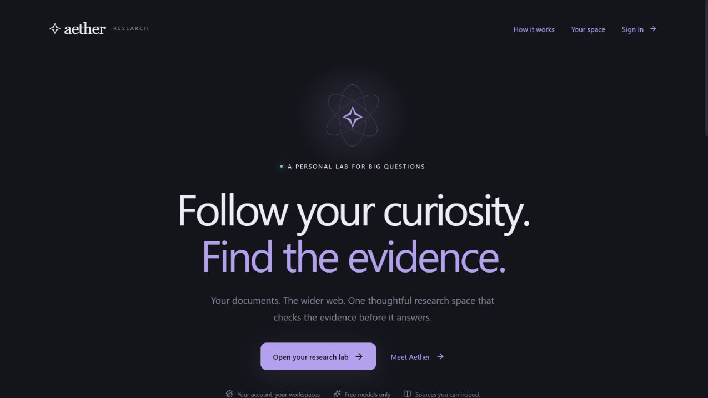

# Verification — Gemini migration

## Navigation-safe research checks (2026-10-10)

- The active stream now belongs to the signed-in browser session instead of the
  chat component. View switches and client-side app navigation preserve research.
  The root auth observer cancels and clears it on sign-out/account changes.
- **18 frontend tests passed**. New real ReadableStream tests exercise continued
  token/final delivery across view switches and same-account page initialization,
  shared Stop, account-change cancellation, duplicate-request prevention, relevance
  request forwarding, stale history refresh isolation, and missing-session refusal.
- TypeScript, ESLint, and the final Next.js production build pass. Tests/builds
  required host execution because of Windows sandbox temporary-file/path access.
- README, LEARNING.md, and ARCHITECTURE.md explain the updated lifecycle. Full
  reloads, closed tabs, and network disconnects still interrupt the stream.
- Authenticated browser navigation and real provider calls were not exercised;
  transport regression tests use controlled SSE responses.

## Relevance control checks (2026-10-10)

- Added a 0–100% per-document-chunk cutoff beside the composer model picker,
  initially 50%, shared with Preferences and disabled during streaming.
- The optional API threshold is validated on the 0–1 scale and overrides only
  the current request. Tests cover invalid/non-finite inputs, both endpoints of
  the range, equality at the cutoff, omitted-field compatibility, and unchanged
  SQLite defaults. Grounding and sufficiency checks remain enabled.
- Intelligence displays the actual cutoff from the grading event. The landing
  example and process copy illustrate the new option.
- Backend: **77 tests passed** with mocked provider calls, using
  `--basetemp .tmp/relevance-host-tests`; Ruff passes for the changed Python files.
- Frontend: **11 tests passed**, TypeScript and ESLint pass, and the production
  build passes after all UI changes.
- The updated landing page was inspected in the local browser at desktop and
  390-pixel mobile width; the mobile page has no horizontal overflow. Signed-in
  composer interaction and real Gemini/Tavily calls were not exercised.

Next.js builds and preview startup required host execution because Windows denied
path canonicalization in the sandbox. Backend tests also required host execution
after sandbox async setup stalled, consistent with the restriction recorded below.

## Gemini revision checks (2026-10-08)

- Backend: **67 tests passed** using the project's Python venv and
  `--basetemp .test-tmp-gemini-final`. Ruff passes; pip reports no broken requirements.
- The venv now uses langchain-google-genai 4.4.0, google-genai 2.29.0,
  and beautifulsoup4 4.15.0. The unused langchain-openai adapter was removed;
  requirements.lock.txt was regenerated. An OpenAI package may remain as a
  transitive Chroma dependency, but application LLM calls use Gemini only.
- Frontend: **10 tests passed**, TypeScript and ESLint pass. The Next.js production
  build passes with landing, private research, auth routes, API proxy, and Clerk middleware.
- Google's actual public pricing HTML was fetched and parsed successfully. Its
  wrapped headings, Standard input/output prices, and excluded specialized models
  are handled. Model access is intersected with the authenticated Models API.
- External API tests use real HTTPX MockTransport and Google's real ClientError
  type. They cover pagination, caching, force-refresh, no keys in request URLs,
  paid/unknown-price exclusion, wrapped 404/429/503 errors, 400/401/403 stopping,
  bounded model attempts, cooldown state, stale model selection, and exhausted quota.
- A graph integration test streams a partial answer, injects a quota error, and
  verifies that the replacement Gemini model streams text blocks and produces
  the accepted cited answer without combining drafts or displaying signatures.
  Additional graph tests check output-token exhaustion and empty-answer fallback.
- Existing document, vector isolation, Clerk ownership, citation, grounding,
  SSE persistence, deletion, and regeneration tests remain passing.

The default Windows sandbox prevented async socket creation; tests were rerun on
the host. Its default pytest temporary folder also denied access, so a fresh,
ignored temporary folder inside the project was used. These environment errors
were resolved before reporting the passing result.

**No Gemini API key is currently configured in the backend.** Authenticated
Models.list and real Gemini answer generation have therefore not been exercised.
Add GEMINI_API_KEY locally, restart the backend, refresh models, then run a real
cited question. Models.list does not expose remaining quota or billing tier.
Use a free-tier project with billing disabled to avoid charges; fallback cannot
bypass limits shared across a Google project. No new latency measurement is claimed.

The browser automation connection was unavailable during this migration, so the
updated Gemini selector was verified by compilation and state tests rather than
a new signed-in browser session. The earlier screenshots below predate Gemini.

The Clerk secret found in the env example was replaced with a blank
placeholder. Runtime environment files were not copied into documentation.

## Historical Clerk revision results (before the Gemini migration)

Executed on 2026-10-08 on Windows with Python 3.12.14 in backend/.venv,
Node.js 24.18.1, npm 11.16.0, Clerk Python SDK 7.0.0 and @clerk/nextjs 7.9.12.

## Final results

| Check | Result |
|---|---|
| Backend pytest | **52 passed** |
| Backend Ruff | Passed |
| Python pip check | No broken requirements |
| Frontend Vitest | **9 passed**, three test files |
| Frontend TypeScript | Passed |
| Frontend ESLint | Passed |
| Next.js production build | Passed, landing/research/auth/API routes and Clerk proxy compiled |
| npm dependency audit during Clerk installation | 0 reported vulnerabilities |
| Live backend health | 200, authentication reported as Clerk |
| Anonymous live workspace API | 401; private access rejected |
| Actual OpenRouter public free catalog | 17 models passed the strict free-ID/zero-price filter at check time |
| Browser console for final pages | No captured warning/error entries |

Final pytest used `--basetemp=.test-tmp-clerk-final-verified`. Test directories are
disposable and ignored. Never select application data as pytest's temporary path.

## Meaningful security and behavior tests

- The actual Clerk SDK verifies generated RSA signatures locally, including
  rejection of a wrong key, malformed token, expired token, and unauthorized origin.
  These are offline tests; their generated credentials are not production credentials.
- Protected API requests without authentication are rejected. Health remains public.
- Two test users cannot list, read, download, upload, rename, reindex, delete, chat
  with, or inspect traces in each other's workspace. Owner IDs in JSON cannot
  override the verified identity.
- Legacy SQLite migration preserves old workspaces with null ownership. The claim
  utility creates a backup and never reassigns someone else's existing workspace.
- Grading executes concurrently with a peak of exactly three requests, preserves
  all six source IDs, and retains validation. Concurrency is tested with scheduling
  synchronization rather than speculative wall-clock speed assertions.
- Free-price filtering rejects paid, negative, missing, nonnumeric and auxiliary
  fees. Availability failures fall back and notify; invalid API keys do not trigger
  model hopping. No paid fallback candidate enters a request's plan.
- Existing extraction, persistent Chroma, deletion, isolation, duplicate prevention,
  staged reindex failure, routing, citation retries, SSE persistence and regeneration
  regression tests pass with mocked external LLM/Tavily calls.
- Frontend tests verify byte-split SSE, Unicode, heartbeats, interruptions, pricing,
  fallback display, provisional-draft resets, and private session-state clearing.

## Browser verification

The real running development frontend was checked at its normal desktop viewport
and at 390 × 844. The landing hero, navigation, descriptions, call to action,
phone layout and section anchor worked. Temporary viewport overrides were reset.

Research and sign-in routes show clear setup screens because no Clerk application
keys were configured. They do not expose a development login bypass.
The standalone Settings and Agent Workflow pages were removed from the app.
The compact evidence graph remains implemented inside the authenticated lab.

## Data preservation

Before restarting the updated backend, a SQLite backup was created in backend/data:
`aether-before-auth-20261008T130946355508.db`.
The updated backend started successfully and migrated the nullable owner column.
Existing workspaces remain unassigned; they were not attached to a guessed user.
Use the explicit claim procedure in README.md after obtaining your real Clerk ID.

## What still requires your external setup

**Hosted Clerk sign-up/sign-in and the complete signed-in browser flow have not
been exercised**, because no Clerk application keys were supplied. Configure the
same Clerk application in backend and frontend/.env.local, restart the backend,
and restart the development frontend (or rebuild its production bundle).

The private workspace/model-picker UI compiles and its state behavior is tested,
but its full hosted-session integration needs a configured Clerk account.
No new authenticated OpenRouter/Tavily research question was run for this revision.
The public model catalog was queried; it does not prove each model is online or
that a free provider will produce a well-cited answer. Earlier real MiniLM and
document API smoke tests passed before authentication; embeddings/indexing code
is unchanged. The live document smoke script now correctly requires a Clerk token.

The previous saved answer's 152-second trace identified sequential grading and
citation regeneration as dominant delays. Those code paths were improved, but
**no new end-to-end latency figure is claimed**. Provider queues, quotas, model
quality, retries, web search and first-use model loading still affect response time.

After configuring Clerk: sign up, create a workspace, upload the sample, select a
free model, ask a document question, inspect citations, test regeneration, then
sign into a second account and confirm isolation. For fallback testing, use the
automated mocked-availability test; a live outage cannot be made deterministic.

No public deployment was performed. Authentication and ownership are implemented;
large-scale quotas, abuse protection, backups and deployment infrastructure remain
operational work before broad public exposure. See README.md for boundaries.

## Gemini availability repair — 13 October 2026

- Full backend suite: 102 passed. After final model-access diagnostics were added,
  the targeted AI, model-catalog, graph, and API regression suite passed 68 tests.
- Frontend: 21 tests passed; TypeScript, ESLint, and production build passed.
- Backend Ruff and Git whitespace checks passed.
- Regression coverage includes wrapped timeouts, HTTP authentication errors,
  concurrent success/failure, incomplete responses, bounded retries, later-node
  recovery, cooldown expiry, key replacement, and safe catalog error propagation.
- Live local key: Models.list returned HTTP 200 with 63 entries. Pricing/catalog
  intersection returned eight eligible text models. A tiny generation request to
  Gemini 2.5 Flash-Lite returned 404, a raw Gemini 3.8 request returned a temporary
  503, and a subsequent tiny request through the application's LangChain client
  and repaired fallback code successfully generated text on Gemini 3.8 Flash.
  No research documents or conversation contents were used in live checks.
- The signed-in production session and production credentials were not inspected.
  These changes remain local and require backend/frontend deployment to apply live.

## Production timeout follow-up — 13–14 October 2026

- Full backend suite: 120 passed; Ruff and Git whitespace checks passed.
- Batched grading supersedes the earlier six-request concurrent implementation.
  Regression tests confirm one model call grades all six chunks, preserves the
  per-chunk threshold, matches judgments by ID, and rejects missing/duplicate or
  unknown IDs. Citation and grounding validation remain enabled.
- Regression tests cover the three-attempt budget, cancellation at the operation
  deadline, direct model switching after timeouts, and stopping on provider errors
  during grading/assessment/validation without web search or regeneration.
- A live local check sent three synthetic snippets through the actual batched
  grading node and Gemini 3.8 Flash. It returned three judgments, accepted the two
  astronomy snippets, rejected an unrelated accounting snippet, and had no warnings.
  No user documents were used. No production latency improvement is claimed yet.
- This follow-up changes the backend only. The Render backend needs deployment;
  no new production deployment was performed in this chat.
